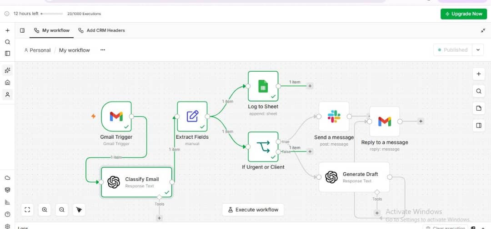
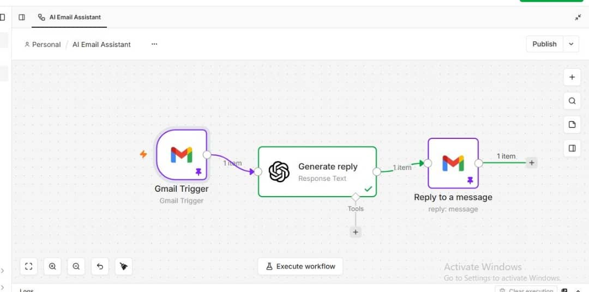
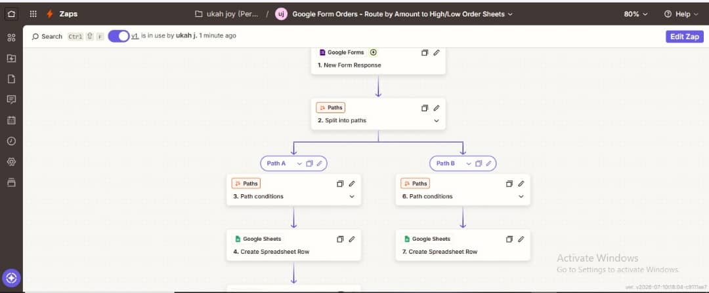
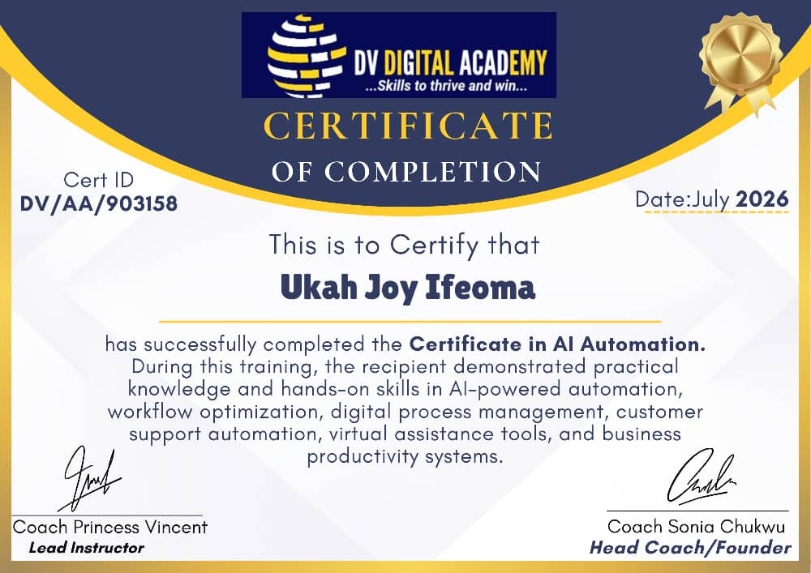

# AI Email Assistant Suite — Production-Grade Gmail Automation
### n8n + Zapier + OpenAI | Idempotency | Retries | Observability

> Built to solve a real business problem: **Never miss a client email, never send duplicate replies, never fail silently.**

I built 3 live automation systems for small businesses — from inbox triage to order routing — handling real Gmail, Forms, Sheets, and Slack APIs.

**Author:** Ukah Joy Ifeoma | AI Automation Engineer | Lagos, Nigeria (Open to Remote)
**Certificate:** DV Digital Academy — Certificate in AI Automation, July 2026 (ID: DV/AA/903158)

---

## 🚀 Live Workflows

### 1. AI Email Assistant (n8n) — Main Project [STAR]
**Flow:** Gmail Trigger → Classify Email (OpenAI) → Extract Fields → If Urgent or Client → Log to Sheet + Slack Alert + Generate Draft → Reply

**Screenshots:** 
- Workflow: `screenshots/01-gmail-triage-workflow.png`

**Production Features I Implemented:**
- **Idempotency:** Uses Gmail `threadId` as unique key. Function node checks Google Sheets for existing threadId before processing — prevents duplicate drafts if webhook fires twice.
- **Resilience:** 3 retries with exponential backoff (1s, 3s, 9s) on OpenAI & Gmail nodes. On final failure → Slack alert with threadId + error.
- **Observability:** Structured logs to Google Sheets: timestamp, threadId, sender, category, priority, status, error.
- **Safety:** Classifies as Urgent / Client / Spam / Support. Only drafts for Urgent/Client.

**Tech:** n8n, Gmail API (Pub/Sub), OpenAI GPT-4, JavaScript (Function node), Google Sheets API, Slack Webhooks

### 2. Order Router (Zapier) — Business Ops Automation
**Problem:** Shop owner couldn't prioritize high-value orders.
**Flow:** Google Form (New Order) → Zapier Paths → Split by Amount → Path A (High Value) → Create Row High Value Sheet | Path B (Low Value) → Low Value Sheet

**Screenshot:** `screenshots/02-order-router-paths.png`

**Impact:** Owner now sees high-value orders first and prioritizes 80% of revenue.
**Tech:** Zapier Paths, Google Forms, Google Sheets, Conditional Logic

### 3. AI Auto-Responder (n8n) — Safe Drafting
**Flow:** Gmail Trigger → Generate Reply (OpenAI) → Reply to Message (Draft mode)
**Screenshot:** `screenshots/03-auto-responder.png`
**Safety Improvements:**
- Filter: Skip if From = my email or Subject contains "Re:" (prevents loops)
- Now set to **Create Draft** not auto-send — human reviews first
- Working on prompt tuning — reducing formality with temperature control---
## 🛠️ Tech Stack
**Automation:** n8n (self-hosted), Zapier
**AI:** OpenAI GPT-4, Prompt Engineering, Structured JSON Output, Zod
**APIs:** Gmail, Google Sheets, Slack, Google Forms
**Engineering Concepts:** Idempotency (threadId), Exponential Backoff Retries, Error Workflows, Structured Logging, Webhook Deduplication
## 📸 Architecture
- Joy (ukahjoyifeoma29-cmd)
## My Builds - Screenshots

Here are the actual workflows I built:

## My Certificate

